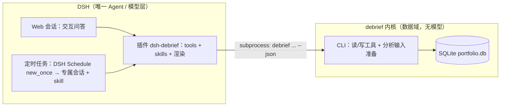

# Architecture · 架构

> English follows the Chinese section.

本插件是 `DSH-DEPLOY-PLUGIN-DESIGN.md`（上游工作区）的 v0.1 实现。设计要点：

## 职责切分



- 模型与多轮对话全部归 DSH；内核只做数据与采集，无模型调用、无 Key 管理。
- DSH session log 是唯一 agent trace；内核只留 `job_runs` 台账 + 报告产出 + 记忆。
- 每次工具调用 = 一次 subprocess（`debrief <command> ... --json`），失败也是结构化 envelope，绝不 throw。

## 插件结构（v0.1）

```
dsh-debrief/
├── src/index.ts           Host 入口（exports "."）
├── src/host/
│   ├── config.ts          配置归一化
│   ├── cli.ts             runCli：spawn + stdin JSON + envelope 归一化
│   ├── schema.ts          零依赖 schema 校验（zod 替代，devDeps 受限）
│   ├── tools.ts           13 个工具（9 只读 + news + 3 白名单写）
│   ├── skills.ts          读取 skills/*.md 并经 ctx.skills.register 注册 5 个技能
│   ├── schedule.ts        schedule/*.json 预置 + `debrief-setup` 命令
│   ├── dashboard.ts       /api/debrief/dashboard 认证路由（ctx.connection.fetch）
│   └── index.ts           apply(ctx)：注册所有资源（ctx.effect 持有 disposer）
├── src/client.ts          单文件浏览器端（无 import；React 取宿主模块表）
├── skills/*.md            5 个中英双语技能
├── schedule/*.json        8 个任务预置（RRULE TZID=Asia/Shanghai、target new_once）
├── mock/debrief.js        模拟内核（含写命令与 job 状态机，文件持久化）
└── tests/*.test.ts        vitest：工具 schema / CLI 映射与 stdin / envelope / 渲染模型 / 降级 / 预置 / 技能 / locale
```

## 关键机制

- **定时任务**：`debrief-setup` 幂等注册（list-then-create，按标题判重）8 个任务；
  `new_once` 每任务一个专属会话、串行交付、错过只补最新；时区显式 `TZID=Asia/Shanghai`。
- **白名单写**：3 个写工具仅定时 skill 会话使用；payload 经 client/server 双端 schema 校验；
  内核 `user_actions` 审计 + 幂等 job 状态机（prepare→running→done/failed+retry）。
- **投资组合（Portfolio）数据**：走 `ctx.connection.fetch` 的认证 exact route（owner cookie），
  不用裸 `webServer.register`（后者无 Peer、无认证——与任务字面表述的偏差，以 inspect 到的现行契约为准）。
- **locale**：Host 导出 locale/*.json（meta）；Client 通过 `ctx.locale.register('dsh-debrief', {zh,en})`
  注册字典、视图收 `t` prop；缺省回退 zh。
- **零运行时依赖**：工具定义用 registry 的编译态 raw schema 形态；client 单文件、无 import；
  devDependencies 仅 typescript/vitest/eslint/prettier。

---

This plugin is the v0.1 implementation of `DSH-DEPLOY-PLUGIN-DESIGN.md` (upstream
workspace). Key points:

## Responsibility split

- All model work lives in the DSH agent; the kernel is model-free data + CLI.
- The DSH session log is the only agent trace; the kernel keeps only the
  `job_runs` ledger, report outputs, and memory.
- Every tool call is one subprocess (`debrief <command> ... --json`); failures
  are structured envelopes, never thrown exceptions.

## Plugin structure (v0.1)

```
dsh-debrief/
├── src/index.ts           Host entry (exports ".")
├── src/host/              config / cli / schema / tools / skills / schedule / dashboard
├── src/client.ts          Single-file browser half (no imports; React from the host module table)
├── skills/*.md            5 bilingual skills
├── schedule/*.json        8 task presets (RRULE TZID=Asia/Shanghai, target new_once)
├── mock/debrief.js        Mock kernel (write commands + job state machine, file-backed)
└── tests/*.test.ts        vitest suites
```

## Key mechanisms

- **Scheduled tasks**: `debrief-setup` registers 8 tasks idempotently
  (list-then-create, deduped by title); `new_once` gives each task a dedicated
  session with serial delivery; the time zone is explicit `TZID=Asia/Shanghai`.
- **Whitelisted writes**: the 3 write tools are for scheduled skill sessions
  only; payloads are validated on both sides; the kernel audits `user_actions`
  and runs an idempotent job state machine.
- **Portfolio data**: served through the authenticated exact route of
  `ctx.connection.fetch` (owner cookie), not a raw `webServer.register` route
  (which carries no Peer and no authentication — a deliberate deviation from
  the task's literal wording, resolved against the inspected contracts).
- **Locale**: Host exports locale/*.json (meta); the Client registers
  `ctx.locale.register('dsh-debrief', {zh,en})`, views receive a `t` prop, and
  the fallback is zh.
- **Zero runtime dependencies**: tools use the registry's compiled raw-schema
  form; the client is a single import-free file; devDependencies are limited to
  typescript/vitest/eslint/prettier.
